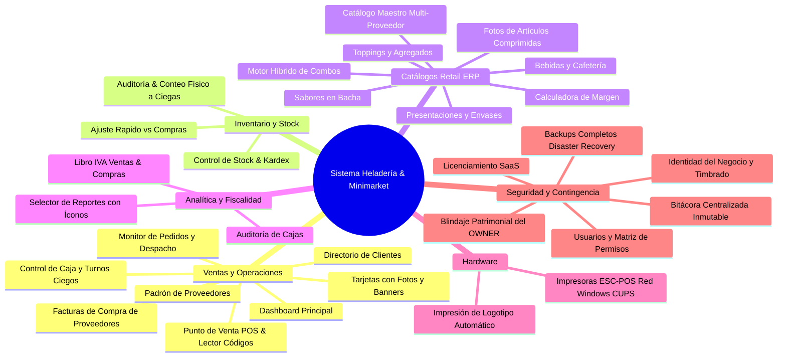

# Dossier de Módulos y Bondades del Sistema
### Sistema Integral de Gestión Retail ERP y Punto de Venta (POS) para Heladerías, Cafeterías y Minimarkets

---

## 1. Resumen Ejecutivo y Arquitectura

Este sistema es una solución empresarial de alta disponibilidad diseñada específicamente para resolver las complejidades operativas del sector gastronómico y de retail comercial (venta fraccionada por peso/potes, combinación de sabores, envases térmicos, toppings, productos de cafetería/minimarket, compras formales a distribuidores, liquidación fiscal y auditoría integral de cambios), combinando máxima agilidad en el punto de venta con un estricto control de inventario, compras, caja, resguardo patrimonial y trazabilidad total de usuarios.

### Stack Tecnológico:
* **Frontend:** Angular 19+ (Standalone Components, Signals reactivas, arquitectura modular, PWA instalable con modo pantalla completa / APK Kiosco, compresión de imágenes al vuelo mediante Canvas HTML5).
* **Backend:** Java Spring Boot 3+, Spring Security con JWT, arquitectura RESTful, hilos virtuales (Java 21) y drivers directos de impresión ESC/POS (TCP Raw, Windows Share SMB y CUPS).
* **Base de Datos:** PostgreSQL 16 Alpine con soporte transaccional ACID, kardex valorizado, auditorías físicas, catálogo maestro multi-proveedor (N:M), almacenamiento fotográfico persistente y bitácora de auditoría inmutable.
* **Infraestructura:** Docker & Docker Compose con proxy inverso Nginx (soporte de subidas de hasta 100 MB) y certificados SSL integrados.

---

## 2. Catálogo Detallado de Módulos y sus Bondades

El sistema cuenta con **22 módulos funcionales** en el menú de navegación, organizados en **6 grandes áreas de negocio**:

---

### ÁREA 1: VENTAS, OPERACIONES Y COMPRAS

#### 1. Dashboard Principal (`/dashboard`)
* **Propósito:** Centro de comando visual con métricas clave en tiempo real.
* **Funcionalidades:**
  * Indicadores rápidos: total facturado hoy, cantidad de pedidos y ticket promedio.
  * Acceso directo al estado de la caja (abierta/cerrada) y alertas inmediatas de reposición de stock.
* **Bondades para el Negocio:** Permite al dueño o encargado conocer la salud financiera y operativa del negocio en los primeros 5 segundos del día sin tener que navegar reportes complejos.

#### 2. Control de Caja y Turnos Ciegos (`/caja`)
* **Propósito:** Gestión integral de turnos de cobro, ingresos, egresos y arqueos de dinero.
* **Funcionalidades:**
  * Apertura de turno con fondo fijo / monto base.
  * Registro de movimientos de efectivo clasificados (gastos menores, retiros autorizados, ingresos extras).
  * Arqueo con **cierre ciego de caja**: el cajero cuenta el dinero físico sin conocer lo que el sistema calcula en pantalla, eliminando cualquier intento de manipulación o cuadre artificial.
  * Historial auditable de todas las sesiones de caja con balance automático de faltantes o sobrantes.
* **Bondades para el Negocio:** **Elimina el robo hormiga y las pérdidas de dinero.** Cada guaraní queda registrado y asociado al operador que abrió y cerró el turno con firma de auditoría.

#### 3. Punto de Venta - POS Táctil & Multimodal (`/pos`) — *Actualizado*
* **Propósito:** Terminal táctil ultra-rápida de ventas pensada para pantallas táctiles, tablets y computadoras de mostrador.
* **Funcionalidades:**
  * **Nuevo Diseño de Tarjetas con Banner Superior Completo (115px):**
    * Los artículos con foto presentan una imagen nítida de borde a borde con efecto zoom interactivo al pasar el cursor (`transform: scale(1.05)`).
    * Los artículos sin foto cuentan con un banner temático con gradiente e ícono centrado de alta visibilidad (amarillo para helados, violeta para toppings, azul para general).
    * **Insignias flotantes semitransparentes (`backdrop-filter: blur(4px)`):** Categoría y estado de stock (disponible, poco stock, agotado) en esquinas superiores sin obstaculizar el nombre ni el precio.
  * **Buscador Multimodal Rápido (3 Opciones):**
    1. **Código de Barras:** Pistola lectora USB/Bluetooth o tecleado manual. Al escanear o presionar `Enter`, el artículo se agrega **automáticamente al ticket** de forma transparente.
    2. **Código de Producto / ID interno:** Para localizar rápidamente artículos codificados en bodega.
    3. **Nombre / Descripción:** Búsqueda incremental instantánea.
  * **Botón Rápido `+` en Artículos:** Permite sumar unidades de cualquier producto empaquetado o bebida con un solo toque directo.
  * Selección dinámica de presentaciones (potes de 1/4 kg, 1/2 kg, 1 kg, cucuruchos, vasitos) con bloqueo automático de bachas agotadas.
  * Control del límite de sabores por presentación y agregados de toppings con precio diferencial.
  * Búsqueda ágil de clientes con validación de RUC paraguayo (Dígito Verificador DV - Módulo 11).
  * Múltiples medios de pago: Efectivo, Tarjeta con **ingreso obligatorio de N° de Voucher POS** y Billetera Digital/QR.
* **Bondades para el Negocio:** **Velocidad extrema de despacho en horas pico** (menos de 15 segundos por cliente), reduciendo filas de espera y brindando una presencia visual moderna y atractiva al cliente.

#### 4. Monitor de Pedidos y Despacho (`/pedidos`)
* **Propósito:** Tablero de comandas estilo Kanban para el despacho en mostrador o cocina.
* **Funcionalidades:** Estados visuales dinámicos (*Pendiente -> En Preparación -> Listo -> Entregado*), detalle de sabores y notas especiales de clientes.
* **Bondades para el Negocio:** Desacopla al cajero del despachador, acelera el armado de pedidos fraccionados y elimina la confusión de pedidos en horas de alta concurrencia.

#### 5. Gestión de Clientes (`/clientes`)
* **Propósito:** Directorio y fidelización de la cartera de clientes.
* **Funcionalidades:** Alta y edición con datos de facturación (RUC/CI con cálculo automático de Dígito Verificador DV Módulo 11) e historial de compras acumuladas.
* **Bondades para el Negocio:** Cumplimiento tributario en facturas legales y base de datos propia para fidelización y promociones.

#### 6. Padrón de Proveedores (`/proveedores`)
* **Propósito:** Directorio comercial de distribuidores mayoristas e importadores.
* **Funcionalidades:** RUC con DV, datos de contacto, cuentas bancarias para transferencias y modal interactivo para consultar el catálogo de artículos provistos con costos pactados y proveedor principal ⭐.
* **Bondades para el Negocio:** Centraliza la información comercial y agiliza la negociación de costos de insumos.

#### 7. Facturas de Compra de Proveedores (`/compras`)
* **Propósito:** Registro formal de facturas de compra comerciales con respaldo fiscal.
* **Funcionalidades:** Carga rápida por código de barras, selección masiva en bloque, alta rápida de artículos en caliente (`+ ¿Artículo nuevo?`), protección contra cierre accidental del formulario, liquidación automática de Crédito Fiscal IVA (10%, 5%, Exentas) y descargas en CSV y PDF A4 con membrete institucional.
* **Bondades para el Negocio:** Garantiza el cómputo exacto del Crédito Fiscal IVA para deducir impuestos ante la SET/DNIT, actualiza los costos pactados por proveedor y alimenta el kardex con respaldo legal.

---

### ÁREA 2: INVENTARIO, ALMACÉN Y STOCK

#### 8. Control de Stock & Kardex (`/stock`)
* **Propósito:** Control en tiempo real de existencias físicas y valor monetario del inventario.
* **Funcionalidades:**
  * Alertas automáticas de stock crítico y mínimo.
  * Control de existencias fraccionadas en kilogramos (`kg`) para helados y unidades (`u`) para envases y productos de minimarket.
  * **Doble Vía de Reposición Claramente Diferenciada:**
    * **Ajuste Rápido / Reposición Operativa:** Para registrar la producción interna de bachas en cocina o ajustes físicos inmediatos sin impacto fiscal ni salida de dinero en caja.
    * **Compras a Proveedores:** Para ingresos de mercadería con factura comercial de distribuidor, cómputo de crédito fiscal y registro en bitácora.
  * Registro de mermas, pérdidas justificadas y kardex cronológico detallado.
  * Interfaz optimizada y limpia sin accesos redundantes para evitar confusiones operativas.
* **Bondades:** Evita quiebres de stock en sabores estrella, transparenta cada movimiento de almacén y asegura que la cocina siempre tenga insumos para producir.

#### 9. Auditoría & Conteo Físico a Ciegas (`/auditoria`)
* **Propósito:** Toma de inventario físico sin exponer las cantidades teóricas del sistema (*Blind Stocktaking*).
* **Funcionalidades:** Carga de cantidades contadas físicamente por los operadores, cálculo automático de discrepancias, aplicación atómica de ajustes, reactivación de sabores agotados con existencia positiva y emisión de Acta Oficial firmada en PDF A4 y CSV.
* **Bondades:** **Elimina por completo la manipulación de números en auditorías físicas**, obligando a un conteo real de la mercadería.

---

### ÁREA 3: CATÁLOGOS RETAIL ERP

#### 10. Catálogo Maestro ERP Multi-Proveedor (`/catalogos/maestro`) — *Actualizado*
* **Propósito:** Gestión unificada de la lista maestra de artículos comerciales, recetas y promociones.
* **Funcionalidades:**
  * Clasificación comercial estricta: `VENTA_DIRECTA`, `ENVASE`, `SABOR`, `TOPPING`, `INSUMO`, `ELABORADO`, `COMBO`, `SERVICIO`, `ACTIVO_FIJO`.
  * **Soporte de Fotos con Compresión al Vuelo (Canvas HTML5):**
    * Selector interactivo de imágenes que comprime y redimensiona las fotos automáticamente en el navegador a 320x320 px en JPEG (~15 a 30 KB).
    * Almacenamiento persistente en formato Base64 dentro de PostgreSQL (`imagen_url`), quedando **100% resguardado dentro de las copias de seguridad de la base de datos**.
  * **Sincronización Automática con Catálogos Operativos:** Al guardar un artículo en el Maestro, su foto, precio y descripción se propagan de forma transparente a los catálogos operativos (sabores, presentaciones, toppings, productos simples) y al POS.
  * **Relación Multi-Proveedor N:M:** Un artículo puede vincularse a múltiples proveedores con costos individuales pactados y asignación de proveedor principal ⭐.
  * **Calculadora Inteligente de Margen Comercial:** Presets de margen neto (**15%**, **20%**, **30%**, **50%**) que calculan en tiempo real el precio de venta sugerido y la rentabilidad esperada.
  * **Motor Híbrido de Combos:**
    * **⚡ Combos Simples:** Promociones a precio cerrado directo.
    * **🧩 Combos Compuestos:** Con despiece y receta de partes (envases, sabores, bebidas, insumos) que descuentan atómicamente el stock de cada componente al cobrarse en el POS, con cálculo automático del costo acumulado.
* **Bondades:** Unifica el modelo comercial y productivo, asegura márgenes de ganancia exactos en combos y previene el desabastecimiento silencioso de ingredientes.

#### 11. Catálogo Operativo: Sabores en Bacha (`/catalogos/sabores`)
* **Propósito:** Parametrización de sabores de helado, bachas disponibles en mostrador, stock en kilogramos y fotos en miniatura.
* **Bondades:** Permite congelar o reactivar bachas con un clic y previene la venta de sabores sin stock en el POS.

#### 12. Catálogo Operativo: Presentaciones y Envases (`/catalogos/presentaciones`)
* **Propósito:** Configuración de formatos de venta (potes térmicos de 1/4 kg, 1/2 kg, 1 kg, cucuruchos y vasitos).
* **Bondades:** Establece el peso exacto a descontar del stock de helado y el límite máximo de sabores que el cliente puede elegir.

#### 13. Catálogo Operativo: Toppings y Agregados (`/catalogos/toppings`)
* **Propósito:** Gestión de agregados dulces (salsas, chocolates, frutas, confites) con precio unitario o incluido.
* **Bondades:** Incrementa el ticket promedio mediante venta sugerida con stock controlado.

#### 14. Catálogo Operativo: Bebidas y Cafetería (`/catalogos/productos`)
* **Propósito:** Gestión de productos simples de venta directa por unidad y lectura de códigos de barra (gaseosas, aguas, café, confitería).
* **Bondades:** Permite operar como minimarket integrado sin necesidad de sistemas separados.

---

### ÁREA 4: ANALÍTICA, FISCALIDAD Y REPORTES

#### 15. Módulo de Reportes y Analítica con Selector de Íconos (`/reportes`)
* **Propósito:** Inteligencia de negocio, cumplimiento impositivo y auditoría contable.
* **Funcionalidades:**
  * **Selector Desplegable con Íconos y Descripciones:** Navegación limpia e intuitiva entre los 9 reportes integrados del sistema.
  * **9 Reportes Integrados:**
    1. Dashboard Ejecutivo
    2. Ventas Detalladas
    3. Compras a Proveedores (Crédito Fiscal IVA)
    4. Libro Ventas IVA (SET / DNIT Hechauka)
    5. Auditoría de Cajas (arqueos y diferencias)
    6. Ranking Productos & Sabores
    7. Reimpresiones Térmicas
    8. Talonarios & Timbrado SET
    9. Inventario & Kardex Valorizado
  * **Exportaciones Oficiales:** Descarga de planillas en **CSV (Excel UTF-8 con BOM)** y **PDF A4 Apaisado** con membrete formal.
* **Bondades para el Negocio:** Información ejecutiva y fiscal al día con un solo clic, reduciendo costos de gestoría contable y facilitando la toma de decisiones.

---

### ÁREA 5: HARDWARE Y DISPOSITIVOS

#### 16. Impresoras ESC/POS Térmicas y Ticketeras (`/impresoras`) — *Actualizado*
* **Propósito:** Conectividad universal con impresoras térmicas de tickets y comandas en anchos estándar de 58 mm y 80 mm.
* **Funcionalidades:**
  * **Triple Conectividad Empresarial:**
    1. **Socket TCP Raw (Red cableada Ethernet o Wi-Fi):** Envío directo por puerto TCP (9100) para máxima velocidad de respuesta.
    2. **Recurso Compartido de Windows (SMB):** Comunicación nativa con ticketeras USB conectadas a otras PCs con Windows en la red local (`\\ip\cola`).
    3. **Servidor CUPS (Linux / macOS):** Integración con el spooler estándar de sistemas Unix.
  * **Impresión de Logotipo Matricial Automático:** Conversión al vuelo del logotipo institucional a mapa de bits monocromático ESC/POS (`GS v 0`), centrado en la cabecera tanto en tickets de venta como en pruebas de impresión.
  * **Modal de Prueba con Diagnóstico en Tiempo Real:** Permite despachar tickets de prueba personalizados con el nombre del negocio, detección automática de logo (`✓ Logo configurado`), verificación de estado y corte de papel.
* **Bondades:** Compatibilidad con cualquier marca comercial del mercado (Epson, Bixolon, Xprinter, Hasar, etc.) sin pagos de licencias de drivers externos y con identidad visual de marca en cada comprobante emitido.

---

### ÁREA 6: SEGURIDAD, AUDITORÍA Y CONTINGENCIA

#### 17. Bitácora Centralizada de Auditoría (`/bitacora`)
* **Propósito:** Registro oficial, inmutable y cronológico de todas las operaciones y cambios del sistema.
* **Funcionalidades:**
  * **Trazabilidad 100% Inmutable:** Registra fecha, hora, usuario, IP, módulo y detalle del cambio con valores anteriores y nuevos (`Valor Anterior ➔ Valor Nuevo`).
  * **Áreas Auditadas:** Modificación de precios de venta y costos, altas/bajas de artículos, compras a proveedores, facturas anuladas con su motivo obligatorio, aperturas/cierres de caja con diferencias de arqueo y ajustes de stock.
  * **4 Tarjetas KPI:** Total de eventos, usuarios con actividad, modificaciones realizadas y bajas/anulaciones.
  * **Filtros Dinámicos:** Presets de fechas (Hoy, Esta Semana, Este Mes, Historial completo), filtros por usuario, módulo, acción y buscador en tiempo real.
  * **Exportación Oficial:** Descargas en **CSV (Excel)** y **PDF A4 Apaisado** con membrete institucional.
* **Bondades para el Negocio:** **Tranquilidad absoluta para los propietarios.** Permite saber con exactitud quién y cuándo modificó un precio, anuló una factura o alteró el stock.

#### 18. Gestión de Usuarios y Blindaje Patrimonial del Propietario (`/usuarios`) — *Actualizado*
* **Propósito:** Administración de cuentas de operadores, control de accesos y protección del dueño del negocio.
* **Funcionalidades:**
  * **Inmunidad Patrimonial del Propietario (OWNER):**
    * La cuenta `owner` y cualquier usuario con rol `OWNER` están **estrictamente blindados** tanto en el backend como en el frontend.
    * Ningún usuario con rol `ADMIN` u operador puede eliminar, suspender o alterar la contraseña de un usuario `OWNER`.
    * En la interfaz se reemplazan los botones de acción por **candados bloqueados (`lock`) y escudos de seguridad (`shield`)**.
  * **Prohibición de Auto-Eliminación:** Ningún usuario activo puede eliminar su propia cuenta en sesión.
  * Bloqueo inmediato de operadores dados de baja y cambio obligatorio de contraseñas.
* **Bondades para el Negocio:** **Paz mental total para los dueños e inversionistas.** Evita sabotajes internos, bloqueos accidentales o tomas de control por parte de administradores o empleados con acceso al sistema.

#### 19. Roles y Matriz de Permisos Granulares (`/roles`) — *Actualizado*
* **Propósito:** Control de acceso granular basado en roles (RBAC) con separación de responsabilidades.
* **Funcionalidades:**
  * **Roles Base Inmutables:** Los roles fundamentales del sistema (`OWNER` y `ADMIN`) no pueden ser borrados ni renombrados en la base de datos.
  * Creación y edición de roles personalizados (Cajero, Despachador, Encargado de Almacén, Auditor) con matriz de permisos por módulo y acción.
* **Bondades para el Negocio:** Principio del menor privilegio: cada empleado accede exclusivamente a las funciones que necesita para su trabajo diario.

#### 20. Identidad del Negocio, Logotipo y Timbrado (`/institucion`)
* **Propósito:** Parametrización de la identidad corporativa y cumplimiento legal tributario.
* **Funcionalidades:** Razón Social, RUC con Dígito Verificador (DV), Timbrado SET/DNIT, fechas de inicio y vencimiento, numeración correlativa de comprobantes y subida de logotipo institucional en alta resolución para tickets e informes.
* **Bondades para el Negocio:** Evita multas fiscales por comprobantes mal emitidos o timbrados vencidos y profesionaliza los comprobantes entregados a los clientes.

#### 21. Licenciamiento & Planes SaaS (`/licencia`)
* **Propósito:** Motor de activación, validación y control de vigencia de licencias comerciales.
* **Funcionalidades:** Validación de llaves de activación con soporte de funcionamiento offline (sin depender de internet para la operativa diaria).
* **Bondades para el Negocio:** Continuidad operativa garantizada aún ante caídas del proveedor de internet.

#### 22. Copias de Seguridad, Resiliencia Total y Disaster Recovery (`/backup`) — *Actualizado*
* **Propósito:** Protección integral de datos ante fallos de hardware, robos de equipos o contingencias operativas.
* **Funcionalidades:**
  * **Independencia Total del Esquema de Datos:**
    * Las copias se generan mediante el motor nativo de PostgreSQL (`pg_dump -Fc` formato `.dump`), lo que asegura que el respaldo cubre **el 100% de las tablas actuales y futuras** (catálogo maestro, fotos de artículos en Base64, recetas de combos, proveedores, auditorías, bitácora inmutable, etc.) sin requerir mantenimiento técnico.
  * **Restauración con un Solo Clic:** Zona de carga drag & drop con soporte de archivos pesados (hasta 100 MB) que restaura la base de datos completa en segundos.
  * Generación y descarga directa del archivo `.dump` firmado con fecha y hora.
* **Bondades para el Negocio:** **El activo más valioso de la empresa (sus datos y clientes) siempre a salvo.** Permite clonar o restaurar el sistema completo en una nueva máquina en menos de 5 minutos ante cualquier eventualidad.

---

## 3. Matriz Resumen de Beneficios Comerciales

| Desafío Típico de Heladerías y Retail | Solución Tecnológica del Sistema | Módulos Clave Involucrados |
|---|---|---|
| **Pérdida de dinero y robo hormiga en caja** | Cierre ciego de turnos sin datos calculados a la vista del cajero y registro de arqueos. | `/caja`, `/reportes` (Auditoría de Cajas) |
| **Colas lentas en horas pico** | POS táctil ultrarrápido con fotos en banner superior, atajos numéricos, escáner de códigos y botón directo `+`. | `/pos`, `/catalogos/maestro` |
| **Bachas agotadas vendidas por error** | Bloqueo en tiempo real de sabores sin stock en las tarjetas del POS. | `/pos`, `/stock`, `/catalogos/sabores` |
| **Descontrol en mermas y conteo físico** | Auditoría física a ciegas con cálculo de diferencias y acta oficial firmada. | `/auditoria`, `/stock` |
| **Incertidumbre en costos y márgenes de combos** | Motor híbrido de combos con despiece atómico de ingredientes y calculadora inteligente de margen (15%, 20%, 30%, 50%). | `/catalogos/maestro` |
| **Riesgo de sabotaje o borrado de cuentas clave** | Blindaje patrimonial absoluto de la cuenta y rol `OWNER` con candados en interfaz. | `/usuarios`, `/roles` |
| **Fallas o incompatibilidad con ticketeras** | Triple protocolo de red (TCP Raw, Windows Share SMB y CUPS) con impresión automática de logotipo. | `/impresoras`, `/institucion` |
| **Riesgo de pérdida de información en siniestros** | Backups completos nativos de PostgreSQL descargables en 1 clic e independientes del esquema. | `/backup` |
| **Falta de respaldo ante auditorías tributarias** | Libro Ventas IVA formal (Hechauka SET/DNIT) y comprobantes de compra con crédito fiscal. | `/reportes`, `/compras` |
| **Falta de claridad en quién hizo cambios sensibles** | Bitácora de auditoría inmutable con registro cronológico de valor anterior vs. nuevo. | `/bitacora` |

