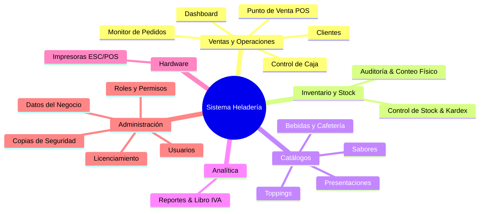

# Dossier de Módulos y Bondades del Sistema
### Sistema Integral de Gestión y Punto de Venta (POS) para Heladerías, Cafeterías y Minimarkets

---

## 1. Resumen Ejecutivo y Arquitectura

Este sistema es una solución empresarial de alta disponibilidad diseñada específicamente para resolver las complejidades operativas del sector gastronómico y de heladerías artesanales (venta fraccionada por peso/potes, combinación de sabores, toppings y productos de cafetería), combinando agilidad en el punto de venta con estricto control de inventario y caja.

### Stack Tecnológico:
* **Frontend:** Angular 19+ (Standalone Components, Signals reactivas, arquitectura modular, PWA instalable con modo pantalla completa / APK Kiosco).
* **Backend:** Java Spring Boot 3+, Spring Security con JWT, arquitectura RESTful y drivers directos de impresión ESC/POS.
* **Base de Datos:** PostgreSQL con soporte transaccional ACID, kardex valorizado y auditorías físicas.
* **Infraestructura:** Docker & Docker Compose con proxy inverso Nginx y certificados SSL integrados.

---

## 2. Catálogo Detallado de Módulos y sus Bondades

El sistema cuenta con **18 módulos funcionales** en el menú de navegación, organizados en **6 grandes áreas de negocio**:

---

### ÁREA 1: VENTAS Y OPERACIONES DIARIAS

#### 1. Dashboard Principal (`/dashboard`)
* **Propósito:** Centro de comando visual con métricas clave en tiempo real.
* **Funcionalidades:**
  * Indicadores rápidos: total facturado hoy, cantidad de pedidos y ticket promedio.
  * Acceso directo al estado de la caja (abierta/cerrada) y alertas de reposición de stock.
* **Bondades para el Negocio:**
  * Permite al dueño o encargado conocer la salud del negocio en los primeros 5 segundos del día sin tener que navegar reportes complejos.

#### 2. Control de Caja (`/caja`)
* **Propósito:** Gestión integral de turnos de cobro, ingresos, egresos y arqueos.
* **Funcionalidades:**
  * Apertura de turno con monto base.
  * Registro de movimientos de efectivo clasificados (gastos chicos, retiros, ingresos extras).
  * Arqueo con **cierre ciego de caja**: el cajero cuenta el dinero físico sin ver lo que el sistema calcula para evitar manipulaciones.
  * Historial auditable de todas las sesiones de caja con balance de faltantes o sobrantes.
* **Bondades para el Negocio:**
  * **Elimina el robo hormiga y las pérdidas de dinero.** Cada centavo queda registrado y asociado al operador que abrió y cerró el turno.

#### 3. Punto de Venta - POS (`/pos`)
* **Propósito:** Terminal táctil ultra-rápida de ventas pensada para pantallas táctiles, tablets y computadoras de mostrador.
* **Funcionalidades:**
  * Selección dinámica de presentaciones (potes de 1/4 kg, 1/2 kg, 1 kg, cucuruchos, vasitos).
  * Control del límite de sabores por presentación (ej.: máximo 3 gustos para 1/2 kg).
  * Agregado de toppings con precio diferencial.
  * Carrito ágil con soporte para múltiples medios de pago (Efectivo, Tarjetas, Transferencia/QR).
  * Emisión automática de ticket fiscal / comanda térmica al confirmar el cobro.
* **Bondades para el Negocio:**
  * **Velocidad de despacho en horas pico.** El cajero procesa una venta compleja en menos de 15 segundos sin equivocarse en la cantidad de gustos ni en el precio fraccionado.

#### 4. Monitor de Pedidos (`/pedidos`)
* **Propósito:** Seguimiento visual del flujo de pedidos desde el cobro hasta la entrega al cliente.
* **Funcionalidades:**
  * Listado en vivo de pedidos clasificados por estados: *Pendiente*, *En Preparación*, *Entregado*, *Cancelado*.
  * Detalle exacto de cada orden: gustos elegidos, toppings, notas especiales y cliente.
  * Reimpresión rápida de tickets extraviados.
* **Bondades para el Negocio:**
  * Sirve como pantalla de despacho o comanda para el personal que arma los helados, desacoplando al cajero del despachador y reduciendo la confusión de órdenes.

#### 5. Gestión de Clientes (`/clientes`)
* **Propósito:** Directorio y fidelización de la cartera de clientes.
* **Funcionalidades:**
  * Alta y edición con datos de facturación (DNI/CUIT/RUT, teléfono, correo y domicilio).
  * Historial de compras por cliente.
  * Búsqueda instantánea desde el POS durante la venta.
* **Bondades para el Negocio:**
  * Construcción de base de datos para marketing, promociones de cumpleaños, delivery recurrente y facturación personalizada.

---

### ÁREA 2: CONTROL DE INVENTARIO Y STOCK

#### 6. Inventario & Stock (`/stock`)
* **Propósito:** Control centralizado de existencias de materias primas y productos de reventa.
* **Funcionalidades:**
  * Kardex detallado de movimientos (entradas por compra, salidas por venta, mermas).
  * Alertas automáticas de stock mínimo y crítico (notificaciones visuales en la barra superior).
  * Valorización monetaria del inventario a precio de costo y venta.
* **Bondades para el Negocio:**
  * **Evita el quiebre de stock** en momentos de alta demanda y ofrece una radiografía exacta del capital inmovilizado en mercadería.

#### 7. Auditoría & Conteo Físico (`/auditoria`)
* **Propósito:** Realización de tomas de inventario periódicas para contrastar stock real vs. stock teórico.
* **Funcionalidades:**
  * Creación de sesiones de conteo físico por sectores o categorías.
  * Comparativa automática: *Stock en Sistema* vs. *Stock Contado* con cálculo de desviaciones.
  * Ajuste automático de stock documentado con motivo de diferencia (vencimiento, merma, rotura).
* **Bondades para el Negocio:**
  * Detección temprana de fugas de mercadería, desvíos en el porcionado de helado y control sobre los inventarios de cierre de mes.

---

### ÁREA 3: CATÁLOGOS Y PRODUCTOS ESPECIALIZADOS

#### 8. Catálogo de Sabores (`/catalogos/sabores`)
* **Propósito:** Administración de la carta de gustos de helado.
* **Funcionalidades:**
  * Alta, baja y modificación de sabores.
  * Switch de disponibilidad instantáneo (apaga un gusto con 1 clic si se terminó en bacha sin borrarlo del sistema).
  * Clasificación por familias (cremas, frutales, chocolates, dulces de leche, especiales).
* **Bondades para el Negocio:**
  * Reflejo inmediato en el POS: los cajeros nunca venderán un gusto que no esté disponible en la vitrina.

#### 9. Presentaciones y Potes (`/catalogos/presentaciones`)
* **Propósito:** Parametrización de los envases y formatos de venta.
* **Funcionalidades:**
  * Configuración de precio, peso estimado en gramos y cantidad máxima de gustos permitidos.
  * Ejemplos: Cucurucho simple (1 gusto), Vaso chico (2 gustos), Pote 1/2 kg (3 gustos), Pote 1 kg (4 gustos).
* **Bondades para el Negocio:**
  * Control estandarizado del modelo de precios y porciones para garantizar el margen de rentabilidad de cada envase.

#### 10. Toppings y Agregados (`/catalogos/toppings`)
* **Propósito:** Gestión de salsas, coberturas y agregados para heladería y cafetería.
* **Funcionalidades:**
  * Asignación de costo extra por agregado (chispas de chocolate, salsas calientes, frutos secos, obleas).
  * Control de disponibilidad.
* **Bondades para el Negocio:**
  * Monetización del up-selling (venta cruzada) aumentando el ticket promedio por cliente.

#### 11. Bebidas y Cafetería (`/catalogos/productos`)
* **Propósito:** Venta directa de artículos de cafetería, confitería y bebidas envasadas.
* **Funcionalidades:**
  * Código de barras, categoría, precio de costo, precio de venta e IVA aplicable.
  * Integración directa con el descuento de stock unitario en cada venta.
* **Bondades para el Negocio:**
  * Permite al local operar como heladería y cafetería al mismo tiempo desde una única pantalla unificada.

---

### ÁREA 4: ANALÍTICA Y REPORTES

#### 12. Reportes y Analítica (`/reportes`)
* **Propósito:** Inteligencia de negocio y reportes impositivos.
* **Funcionalidades:**
  * **Reporte de Ventas:** Filtros por rango de fechas, medios de pago y operadores.
  * **Libro IVA Ventas:** Con desglose de bases imponibles e impuestos, **exportable a CSV** listo para enviar al contador.
  * **Reporte de Cajas:** Histórico de diferencias de caja y turnos.
  * **Ranking de Productos y Sabores:** Gráficos de los artículos y gustos más vendidos (Top Sellers).
* **Bondades para el Negocio:**
  * Decisiones basadas en datos reales: saber qué gustos discontinuar, cuáles reponer en mayor volumen y tener la contabilidad lista sin trabajo manual extra.

---

### ÁREA 5: HARDWARE Y DISPOSITIVOS

#### 13. Impresoras ESC/POS (`/impresoras`)
* **Propósito:** Integración directa con impresoras térmicas de tickets y comandas.
* **Funcionalidades:**
  * Soporte para impresoras térmicas USB, de Red (Ethernet/Wi-Fi) o Bluetooth.
  * Selección de ancho de papel: formato estándar de **58 mm** o **80 mm**.
  * Botón de **"Prueba de Impresión"** para diagnóstico directo del puerto y papel.
  * Impresión de encabezado con logo/datos de la empresa y pie de ticket personalizado.
* **Bondades para el Negocio:**
  * Emisión física de comprobantes sin requerir drivers complejos en cada estación; imprime directamente desde el backend a los puertos de red/USB.

---

### ÁREA 6: SEGURIDAD, ADMINISTRACIÓN Y SISTEMA

#### 14. Usuarios (`/usuarios`)
* **Propósito:** Gestión de operadores que interactúan con el sistema.
* **Funcionalidades:**
  * Alta de usuarios con asignación de roles.
  * Bloqueo/activación de acceso inmediato.
  * Obligatoriedad de cambio de contraseña en el primer inicio de sesión para máxima seguridad.
* **Bondades:**
  * Trazabilidad completa: cada venta, apertura de caja o movimiento de stock tiene nombre y apellido.

#### 15. Roles y Permisos (`/roles`)
* **Propósito:** Control de acceso basado en roles (RBAC).
* **Funcionalidades:**
  * Creación de roles personalizados (ej.: Administrador, Cajero, Encargado de Turno, Mozo).
  * Matriz granular de permisos por pantalla: el cajero solo ve POS y Caja; el encargado ve Stock; el administrador ve todo.
* **Bondades:**
  * Protege la información confidencial de costos, reportes de facturación y configuraciones contra empleados no autorizados.

#### 16. Licenciamiento & Planes (`/licencia`)
* **Propósito:** Motor de activación y validación de licencias comerciales.
* **Funcionalidades:**
  * Validación de clave de activación encriptada con fecha de vencimiento y plan contratado.
  * Vista de planes disponibles (Básico, Profesional, Enterprise).
* **Bondades:**
  * **Convierte el sistema en un producto comercial listo para cobrar suscripción mensual (SaaS) o pagos anuales.**

#### 17. Datos del Negocio (`/institucion`)
* **Propósito:** Personalización de la identidad de la marca en el sistema.
* **Funcionalidades:**
  * Carga de Logotipo en base64 (se muestra en el encabezado del sistema y en los tickets impresos).
  * Razón social, identificación tributaria (CUIT/RUT/RFC), dirección, teléfono, pie de página del ticket.
* **Bondades:**
  * Da aspecto profesional a los comprobantes de los clientes y adapta el sistema a la identidad visual de la heladería.

#### 18. Copias de Seguridad (`/backup`)
* **Propósito:** Resguardo y recuperación de desastres de la base de datos PostgreSQL.
* **Funcionalidades:**
  * Generación de respaldo completo con 1 solo clic.
  * Descarga del archivo `.dump` / `.sql` a la computadora local.
  * Restauración directa desde el navegador o desde archivos del servidor.
* **Bondades:**
  * **Tranquilidad absoluta para el dueño.** Si la computadora se daña, se restaura la información en otra máquina en menos de 5 minutos sin perder ventas ni clientes.

---

## 3. Bondades Técnicas Transversales (Diferenciadores Clave)

| Característica | Beneficio Técnico | Impacto Comercial |
|---|---|---|
| **Operación en Red Local (Sin Internet)** | Funciona 100% sobre Docker local o servidor interno en red LAN. | Si la heladería se queda sin servicio de internet, las cajas **siguen vendiendo e imprimiendo** con normalidad. |
| **PWA Pantalla Completa (Modo APK)** | Instalable en Android, Windows o tablets con selector de pantalla completa inmersiva. | No requiere pagar costos de publicación en Google Play Store; se instala en tablets de mostrador como una app nativa. |
| **Diseño Responsive y Táctil** | Interfaz optimizada con botones de gran tamaño y contrastes de color pensados para pantallas táctiles. | Disminuye los errores de digitación de los operadores en el mostrador. |
| **Seguridad de Nivel Empresarial** | Contraseñas con hashing BCrypt, tokens JWT con expiración, y validación estricta de permisos tanto en front como en back. | Cumple con los estándares modernos de seguridad y auditoría de software. |

---

## 4. Guía de Monetización Sugerida

Para comercializar este sistema se sugieren tres esquemas:

### Esquema A: Suscripción Mensual (SaaS) — *Recomendado*
* **Plan Básico ($30 - $45 USD/mes):** POS, Caja, Clientes, Catálogos e Impresoras (hasta 2 usuarios).
* **Plan Profesional ($60 - $90 USD/mes):** Todo lo anterior + Inventario/Kardex, Auditoría de Stock, Reportes y Libro IVA (usuarios ilimitados).
* **Sucursal Adicional ($50 USD/mes c/u).**

### Esquema B: Licencia Perpetua (On-Premise / Servidor Local)
* **Licencia de por vida por local:** **$800 - $1.800 USD**.
* **Costo de instalación y puesta en marcha:** **$150 - $300 USD** (pago único inicial).
* **Abono de mantenimiento y soporte opcional:** **$30 - $50 USD/mes**.

### Esquema C: Venta del Código Fuente / Derechos
* **Venta llave en mano (Front + Back + BD + Docker):** **$6.000 - $15.000 USD**.
